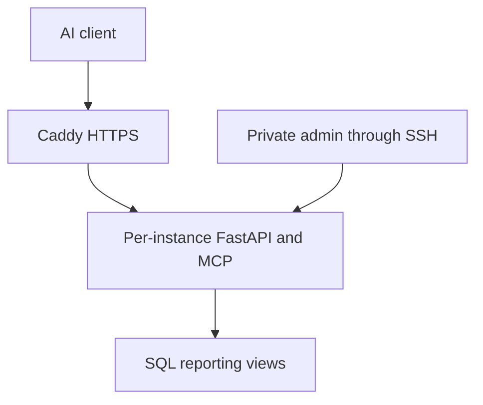

# Architecture and query contract

## Request paths

Each instance is a separate process and Linux identity, with a separate loopback port, SQL identity, admin token, participant list and issuer-bound OAuth database. Several hostnames can share a static public IP. A shared application installation does not imply shared runtime state.

## Source map

| File | Responsibility |
| --- | --- |
| app.py | Private admin routes, reporting tools, authorization integration, publication and previews |
| models.py | Strict configuration/query validation |
| query.py | Approved SELECT compiler and bound filter values |
| database.py | ODBC/TLS, metadata, cursor cleanup, bounded execution and redacted diagnostics |
| oauth.py | SDK-backed authorization protocol and private persistent grants |
| storage.py | Immutable catalogs and atomic revision-checked publication |
| setup.py | Separate connection and field-dictionary drafts |
| limits.py | Request-body bound |
| static/admin.html | Existing-instance configuration workflow |
| scripts/import_column_remarks.py | Generic private-API JSON remarks import |

Source files above are under src/devlens_reporting except the scripts helper.

## Persistent files

| File | Contents |
| --- | --- |
| instance.json | Instance identity, active connection, participant token hashes and catalog reference |
| catalog-SHA256.json | Immutable published dataset dictionary |
| setup.json | Saved SQL settings and per-object field remarks |
| sql-password | Private SQL password bytes; never returned by the API |
| oauth.sqlite3 | Issuer binding, registered clients, consent/grants and token hashes |
| Protected environment file | Admin token and service options; optional SQL password fallback |

Store these outside the checkout, with restricted ownership and permissions. Keep the manifest and its referenced catalog together. A schema/remarks save does not imply a catalog publish.

One service worker is supported per instance. Publication locks and query concurrency are process-local; multiple independent workers sharing one directory are not a supported deployment model.

## Query contract

query_dataset takes a query object containing dataset and optionally:
- fields: detail projections.
- filters: AND-combined predicates.
- group_by and measures: server-side aggregation.
- order_by: ascending output columns/measure aliases.
- limit: 1–1000 rows.

Measures: sum, avg, min, max, count. Count is the count of non-null values in a column, not a distinct count. Filters: eq, ne, gt, gte, lt, lte, is_null, is_not_null. Date values use ISO dates/datetimes.

Identifiers and operations are validated against the catalog and compiled into quoted SQL. Values are bound parameters. Queries cannot submit expressions, joins, functions, DDL/DML or procedure execution.

The compiler requests limit+1 rows so truncation can be identified. Responses include the dataset/catalog identity, requested query, rows and truncation flag. SQL decimals are strings to preserve exact values; date/time values are serialized. Text cells and total response size are bounded. Separate calls may see different database state.

Current caps include 30 projected fields, 20 filters, 10 grouping fields, 10 measures, 10 ordering fields, 100 catalog columns per dataset, two concurrent SQL queries per process, 256 KiB request bodies, 2 MB checked query results and 16000 characters per text cell.

## Modeling limitations

Month/year buckets, calculated measures and joins belong in approved SQL views. Relationships are documented but not executed. Paging, descending order, arbitrary date expressions, COUNT DISTINCT and multi-result snapshots are not implemented. If results exceed the row/group cap, narrow the request or create an appropriate reporting view rather than presenting a sample as the whole population.

Dataset grants do not impose row filters. An identifier used in a filter must be a published column; there is no filter-only internal column classification. Business-rule text informs client behavior but does not enforce field hiding, metric correctness or cancellation logic.
